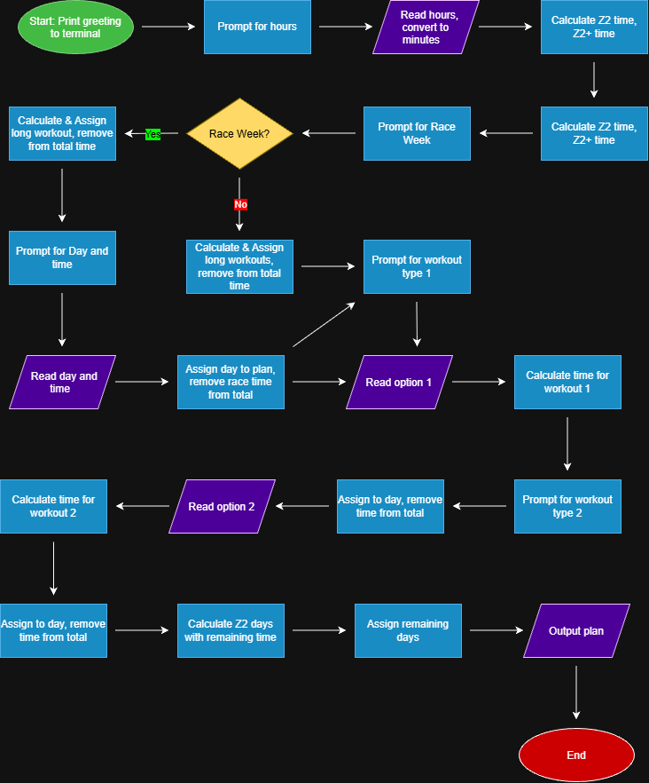

# Project Name

Weekly Workout Planner.

## The Problem

Prompts user for weekly total hours and preferred workout types to construct a weekly plan. Supports race weekend selection.

## How It Works

- Greets user
- Prompts for hours
- Prompts for race weekend selection
- Prompts for workout types
- Reads user input and calculates workout times based on choices made
- Outputs completed plan



## Tech Stack

- **Language:** Java
- **Libraries:** Java.io, Java.util, Java.lang.Math
- **External tools:** N/A

## Setup

Step-by-step:

Install java if not already installed.
To check if java is installed:
```bash
java -version
```

If java is not installed:
```bash
sudo apt update
sudo apt install default-jre
```

Once Java is confirmed installed:
```bash
git clone https://github.com/a-sappey/Weekly-Workout-Planner
cd Weekly-Workout-Planner/src
java main.java
```

## Usage:

Enter project directory:
```bash
cd Weekly-Workout-Planner/src
```
Then start program:
```bash
java main.java
```

Follow prompts in terminal to create desired workout plan.

## Roadmap

- [ ] Stat tracking & summaries
- [ ] Race Season support
- [ ] More schedule types ( <7 days/week)
- [ ] Workout "block" support

## Author

Alex Sappey, https://github.com/a-sappey.